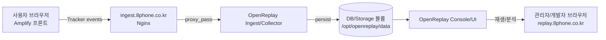

# (Codex 5 에이전트 모드) AWS EC2 Ubuntu + Docker — OpenReplay “실행형” 상세 구현 계획 (고도화 v2)
> 이 문서는 **EC2 Ubuntu에서 Codex CLI를 설치**하고, 에이전트가 **디렉토리/파일 생성 → 명령 실행 → HTTPS 발급 → 기동 검증**까지 완료할 수 있도록 “실행 단계”로 쪼갠 운영 문서다.  
> 배포 방식: **EC2 + Docker Compose + Nginx Reverse Proxy**  
> TLS 종료는 아래 중 하나를 선택한다:  
> - **Let’s Encrypt(EC2/Nginx)**  
> - **ALB + ACM (TLS는 ALB에서, EC2는 HTTP 전용)**  
> 도메인 구성 확정: `*.8phone.co.kr` 하위로 구성  
> - 콘솔: `replay.8phone.co.kr`  
> - 수집: `ingest.8phone.co.kr`

---

## 0) 완료 기준(Exit Criteria)
- [ ] EC2에서 `docker compose up -d`로 OpenReplay 스택이 정상 기동(재부팅 후 자동 기동 포함)
- [ ] `https://replay.8phone.co.kr` 접속/로그인 가능
- [ ] `https://ingest.8phone.co.kr`로 프론트 트래커 이벤트 수신 → 콘솔에 세션 생성 확인
- [ ] 인증서 자동 갱신 구성 완료(LE)
- [ ] 데이터 볼륨(EBS)로 영속화(컨테이너 재시작/업데이트에도 데이터 유지)
- [ ] 백업/업그레이드/롤백 절차 문서 1페이지 이상 확보

---

## 1) 사전 준비(입력값) — 에이전트에게 반드시 제공
아래 값이 없으면 작업이 멈춘다.

- [ ] **EC2 접속 정보**: `ssh -i <pem> ubuntu@<ip>`
- [ ] **TLS 종료 방식**
  - [ ] Let’s Encrypt (EC2에서 발급/갱신)
  - [ ] ALB + ACM (ALB에서 TLS 종료)
- [ ] **DNS 설정 완료 여부**
  - [ ] Let’s Encrypt 방식:  
        `replay.8phone.co.kr` A레코드 → EC2 Public IP(또는 Elastic IP)  
        `ingest.8phone.co.kr` A레코드 → EC2 Public IP(또는 Elastic IP)
  - [ ] ALB + ACM 방식:  
        `replay.8phone.co.kr` CNAME → ALB DNS  
        `ingest.8phone.co.kr` CNAME → ALB DNS
- [ ] **OpenReplay 목표 버전/태그**(고정 권장): 예) `vX.Y.Z` 또는 안정 태그
- [ ] (선택) **관리자 IP allowlist**: 관리자 접근을 특정 IP로 제한할지 여부

---

## 2) 디렉토리 구조(강제 표준)

> 모든 운영 파일은 아래 구조를 기준으로 배치한다.  
> **에이전트는 이 구조를 그대로 생성하고** 파일을 정확한 위치에 작성한다.

```
/opt/openreplay
├─ .env
├─ docker-compose.yml
├─ README_RUNBOOK.md                # (에이전트가 생성) 운영 실행/점검 요약
├─ data/                            # 영속 데이터 루트(EBS)
│  ├─ db/                           # DB 볼륨(구성에 따라)
│  ├─ storage/                      # 세션/첨부/객체 저장소 볼륨(구성에 따라)
│  └─ logs/                         # (선택) 서비스 로그 볼륨
├─ nginx/
│  └─ conf.d/
│     ├─ replay.conf                # replay.8phone.co.kr vhost
│     └─ ingest.conf                # ingest.8phone.co.kr vhost
└─ scripts/
   ├─ healthcheck.sh                # (에이전트가 생성) 외부/내부 헬스체크 스크립트
   ├─ backup_snapshot.md            # (에이전트가 생성) 백업(스냅샷) 절차 메모
   └─ upgrade_rollback.md           # (에이전트가 생성) 업그레이드/롤백 절차
```

---

## 3) 플로우 차트(운영 흐름/배포 흐름)

### 3.1 배포/기동 흐름(EC2)
```mermaid
flowchart TD
  A[EC2 Ubuntu 준비] --> B[Docker & Docker Compose 설치]
  B --> C[/opt/openreplay 구조 생성]
  C --> D[OpenReplay docker-compose.yml & .env 작성]
  D --> E[Nginx reverse proxy vhost 작성]
  E --> F[Let's Encrypt 인증서 발급(2도메인)]
  F --> G[docker compose up -d]
  G --> H[curl로 HTTPS 응답 확인]
  H --> I[replay 콘솔 로그인/프로젝트 키 발급]
  I --> J[systemd 자동기동 등록]
  J --> K[백업/로그/모니터링 최소 세팅]
```

### 3.2 런타임 데이터 흐름(프론트 → OpenReplay)


---

## 4) Codex CLI 설치(EC2 Ubuntu) — “에이전트 실행 환경” 준비

### 4.1 Node.js 18+ 설치(권장)
- [ ] `node -v`가 18 이상인지 확인(아니면 설치)
- [ ] `npm -v` 확인

### 4.2 Codex CLI 설치
- [ ] `npm install -g @openai/codex`
- [ ] `codex --version` 확인

### 4.3 Codex 로그인(인터랙티브)
- [ ] `codex` 실행 후 안내에 따라 로그인(계정 또는 API Key)
- [ ] 로그인 후 `~/.codex/config.toml` 생성 확인

### 4.4 Codex CLI 안전 설정(권장)
- [ ] 작업은 반드시 `/opt/openreplay` 아래에서만 수행하도록 운영 규칙 고정
- [ ] 운영 서버에서 불필요한 권한/명령 실행을 최소화

---

## 5) EC2 시스템 기본 셋업(운영 안정화)

### 5.1 패키지 업데이트 + 유틸
- [ ] `sudo apt-get update && sudo apt-get upgrade -y`
- [ ] `sudo apt-get install -y git curl ca-certificates jq unzip ufw`

### 5.2 방화벽(UFW) (선택)
- [ ] `sudo ufw allow 22/tcp`
- [ ] `sudo ufw allow 80/tcp`
- [ ] `sudo ufw allow 443/tcp`
- [ ] `sudo ufw enable`

### 5.3 디렉토리 생성(강제)
- [ ] `sudo mkdir -p /opt/openreplay/nginx/conf.d /opt/openreplay/data /opt/openreplay/scripts`
- [ ] `sudo chown -R ubuntu:ubuntu /opt/openreplay`

---

## 6) Docker / Docker Compose 설치 및 검증

### 6.1 Docker 설치
- [ ] Docker 설치(공식 방식)
- [ ] `docker --version` 확인
- [ ] `sudo usermod -aG docker ubuntu` 후 재로그인(또는 `newgrp docker`)

### 6.2 Docker Compose
- [ ] `docker compose version` 확인

#### 6.2.1 설치 확인 명령
```bash
docker --version
docker compose version
```

### 6.3 헬스 체크
- [ ] `docker run --rm hello-world` 성공

---

## 7) OpenReplay 스택 배치(/opt/openreplay) — 파일 생성/구성

### 7.1 생성할 파일 목록(강제)
- [ ] `/opt/openreplay/docker-compose.yml`
- [ ] `/opt/openreplay/.env`
- [ ] `/opt/openreplay/nginx/conf.d/replay.conf`
- [ ] `/opt/openreplay/nginx/conf.d/ingest.conf`
- [ ] `/opt/openreplay/scripts/healthcheck.sh`
- [ ] `/opt/openreplay/README_RUNBOOK.md`

### 7.2 `.env` 필수 항목(최소)
> 실제 변수명/필수값은 선택한 OpenReplay 공식 compose 버전에 따라 달라질 수 있다.  
> 에이전트는 **공식 compose 기준으로 누락 없이** 채운다.

- [ ] `PUBLIC_REPLAY_URL=https://replay.8phone.co.kr`
- [ ] `PUBLIC_INGEST_URL=https://ingest.8phone.co.kr`
- [ ] OpenReplay 서비스 요구 DB/스토리지/비밀키 관련 환경변수 일체
- [ ] (가능한 경우) 관리자 초기 계정/초기 패스워드 설정

### 7.3 docker-compose.yml 구성 원칙(필수)
- [ ] OpenReplay 핵심 서비스(콘솔/UI, ingest/collector, DB/스토리지 등) 포함
- [ ] 데이터는 `/opt/openreplay/data`로 영속화(bind mount 또는 named volume)
- [ ] Nginx는 프록시 전용 서비스로 compose에 포함(권장)
- [ ] 외부 노출 포트는 Nginx(80/443)만
- [ ] 내부 서비스 포트는 도커 네트워크로만 연결

---

## 8) Nginx Reverse Proxy 구성(도메인 분리)

### 8.1 replay.conf (콘솔)
- [ ] `server_name replay.8phone.co.kr;`
- [ ] `location / { proxy_pass http://<콘솔서비스>:<포트>; ... }`
- [ ] Websocket/업로드 고려: `proxy_http_version 1.1`, `Upgrade`, `Connection` 헤더 처리
- [ ] `client_max_body_size 50m` 이상 권장
- [ ] `proxy_read_timeout 300s` 이상 권장

### 8.2 ingest.conf (수집)
- [ ] `server_name ingest.8phone.co.kr;`
- [ ] `location / { proxy_pass http://<ingest서비스>:<포트>; ... }`
- [ ] CORS/Origin(가능하면): Amplify 도메인만 허용

---

## 9) Let’s Encrypt(인증서) 발급/자동 갱신

### 9.1 발급 전 체크
- [ ] DNS A레코드가 EC2 IP로 연결됨
- [ ] 80 포트 외부 접근 가능

> **ALB + ACM 구성 시**  
> Let’s Encrypt/Certbot는 사용하지 않는다.  
> TLS 종료는 ALB에서 하고, EC2/Nginx는 **HTTP(80)만** 사용한다.  
> 이 경우 9장(LE)과 certbot 서비스는 생략한다.

> **ALB + ACM을 사용하지 않는 경우(= LE 사용)**  
> 9장(LE) 절차를 그대로 수행한다.  
> 이때 Nginx는 80/443 모두 리슨하며, certbot 서비스가 필요하다.

### 9.2 발급(2도메인)
- [ ] `replay.8phone.co.kr` 인증서 발급
- [ ] `ingest.8phone.co.kr` 인증서 발급

### 9.3 자동 갱신
- [ ] cron 또는 systemd timer로 갱신
- [ ] 갱신 후 Nginx reload 자동 수행

---

## 10) 기동/검증(필수 명령 시퀀스)

### 10.1 기동
- [ ] `/opt/openreplay`에서 `docker compose up -d`
- [ ] `docker compose ps`로 상태 확인
- [ ] `docker logs <nginx>`로 프록시 에러 확인

#### 10.1.6 ALB 환경(HTTP 전용) 적용
ALB/ACM을 사용하는 경우:
- Nginx는 `80`만 리슨
- compose에서 `certbot` 제거
- Nginx vhost에서 `ssl_certificate` 블록 제거

ALB/ACM을 사용하지 않는 경우(= LE 사용):
- Nginx는 `80`/`443` 리슨
- compose에서 `certbot` 유지
- LE 발급/갱신 절차 수행

#### 10.1.1 이미지 태그 오류 대응
`bitnami/redis:6.0.12-debian-10-r33`가 **not found**로 실패하는 경우가 있음.  
아래 중 하나로 `REDIS_VERSION`을 바꾼 뒤 재시도:

```bash
sed -i 's/REDIS_VERSION=\"6.0.12-debian-10-r33\"/REDIS_VERSION=\"6.0\"/' /opt/openreplay/common.env
# 또는
sed -i 's/REDIS_VERSION=\"6.0.12-debian-10-r33\"/REDIS_VERSION=\"6.0-debian-10\"/' /opt/openreplay/common.env
```

이후 재기동:
```bash
cd /opt/openreplay
docker compose up -d
```

#### 10.1.2 Bitnami 레거시 레포 전환(필수 가능성)
2025년 8~9월 이후 Bitnami의 **버전 고정 태그**가 `docker.io/bitnami`에서 제거될 수 있음.  
이 경우 `bitnami/*` 이미지를 **bitnamilegacy/*로 변경** 후 재기동.  
예:
```yaml
image: bitnamilegacy/postgresql:${POSTGRES_VERSION}
image: bitnamilegacy/redis:${REDIS_VERSION}
image: bitnamilegacy/minio:${MINIO_VERSION}
```
설명: Bitnami는 기존 버전 태그를 레거시 레포로 이동하며, 메인 레포에서는 최신 일부만 남기는 정책으로 전환됨.

#### 10.1.3 마이그레이션 프로파일 이미지 오류 대응
`docker compose --profile migration up -d` 실행 시 아래 이미지가 **not found**로 실패할 수 있음:
- `bitnami/minio:2020.10.9-debian-10-r6`
- `bitnami/postgresql:14.5.0`

해결: 마이그레이션용 이미지도 `bitnamilegacy/*`로 변경 후 재시도.
```yaml
image: bitnamilegacy/minio:2020.10.9-debian-10-r6
image: bitnamilegacy/postgresql:14.5.0
```

#### 10.1.4 MinIO 마이그레이션 이미지 대체(mc)
`bitnamilegacy/minio:2020.10.9-debian-10-r6`도 **not found**일 경우,  
`minio/mc` 이미지를 사용해 `mc` 명령으로 버킷 초기화를 수행한다.  
예시(태그는 릴리스 기준):
```yaml
image: minio/mc:RELEASE.2025-08-13T08-35-41Z-cpuv1
```
`mc`는 MinIO 클라이언트이며 `mc alias set`, `mc mb`, `mc policy set` 등을 지원한다.

#### 10.1.5 마이그레이션 환경변수/스키마 경로 오류 대응
`minio-migration` 로그에 `MINIO_HOST`/`MINIO_ACCESS_KEY`가 비어 있다는 경고가 나오면,
`docker-compose.yml`의 스크립트 내 변수를 `$$`로 이스케이프해야 한다.
또한 `db-migration`이 `init_schema.sql: Is a directory` 오류를 내면
**스키마 파일 경로가 잘못된 것**이므로, 실제 파일 경로로 마운트를 수정해야 한다.

예:
```yaml
entrypoint:
  - /bin/sh
  - -c
  - |
      until mc alias set minio "$$MINIO_HOST" "$$MINIO_ACCESS_KEY" "$$MINIO_SECRET_KEY"; do
        sleep 2
      done

volumes:
  - ./schema/db/init_dbs/postgresql/init_schema.sql:/tmp/init_schema.sql
```

### 10.2 외부 헬스 체크
- [ ] `curl -I https://replay.8phone.co.kr`가 200/30x 응답
- [ ] `curl -I https://ingest.8phone.co.kr`가 200/40x(서비스 규격에 따라) 응답

### 10.3 콘솔 검증
- [ ] 브라우저로 `https://replay.8phone.co.kr` 접속
- [ ] 관리자 계정 생성/로그인
- [ ] 프로젝트 생성 및 **Project Key** 확보(프론트에 전달)

---

## 11) 운영 필수(재부팅 자동 기동 + 로그/백업)

### 11.1 systemd로 compose 자동 기동
- [ ] `/etc/systemd/system/openreplay.service` 생성
- [ ] `ExecStart=/usr/bin/docker compose -f /opt/openreplay/docker-compose.yml up -d`
- [ ] `ExecStop=/usr/bin/docker compose -f /opt/openreplay/docker-compose.yml down`
- [ ] `sudo systemctl enable --now openreplay`

> **참고(Here-doc 종료)**  
> `tee <<'UNIT' ...` 형태는 마지막 줄의 `UNIT`으로 종료된다.

### 11.2 로그/디스크 관리(현실 핵심)
- [ ] `/opt/openreplay/data` 사용량 모니터링(알림 권장)
- [ ] docker 로그 로테이션 설정(`/etc/docker/daemon.json`)

### 11.3 백업(최소)
- [ ] 주 1회 EBS 스냅샷
- [ ] `/opt/openreplay` 구성 파일 git/tar 백업

---

## 12) Codex 5 에이전트 모드 — “실행 프롬프트(그대로 사용)”

```text
목표: EC2 Ubuntu에서 /opt/openreplay 경로에 OpenReplay(자체호스팅) 스택을 Docker Compose로 배포하고,
Nginx reverse proxy + Let's Encrypt HTTPS(2도메인: replay.8phone.co.kr, ingest.8phone.co.kr)까지 구성하여
외부에서 https://replay.8phone.co.kr 접속/로그인, ingest 수집이 가능하도록 만든다.

작업 규칙:
1) 모든 작업은 /opt/openreplay 아래에서 수행하고, 생성/수정한 파일 경로를 작업 끝에 나열한다.
2) 외부 노출 포트는 80/443만 사용하고, 나머지는 도커 내부 네트워크로만 연결한다.
3) 데이터는 /opt/openreplay/data로 영속화한다(컨테이너 재시작/업데이트에도 유지).
4) 인증서는 Let's Encrypt로 replay/ingest 각각 발급하고 자동갱신을 설정한다.
5) 최종 검증: curl로 두 도메인에 HTTPS 응답 확인 + 콘솔 접속 후 프로젝트 키 발급 절차까지 안내한다.

사전 제공 정보:
- 도메인: replay.8phone.co.kr, ingest.8phone.co.kr
- OpenReplay 목표 버전(태그): <version>
- EC2 OS: Ubuntu 22.04
- 보안그룹: 22(제한), 80/443(오픈)
```

---

## 13) 에이전트 산출물 체크리스트(반드시 남길 것)
- [ ] 생성/수정 파일 목록:
  - `/opt/openreplay/docker-compose.yml`
  - `/opt/openreplay/.env`
  - `/opt/openreplay/nginx/conf.d/replay.conf`
  - `/opt/openreplay/nginx/conf.d/ingest.conf`
  - `/opt/openreplay/scripts/healthcheck.sh`
  - `/opt/openreplay/README_RUNBOOK.md`
  - (선택) `/etc/systemd/system/openreplay.service`
- [ ] 실행한 명령 전체 로그(설치/기동/인증서 발급/갱신)
- [ ] 헬스체크 결과:
  - `curl -I https://replay.8phone.co.kr`
  - `curl -I https://ingest.8phone.co.kr`
- [ ] 콘솔 프로젝트 키 발급 완료 확인(키 값은 별도 안전 채널로 관리)

---

## 14) 운영 자동화 스크립트 — PG 비밀번호 회전(무중단 재기동 포함)
> 목적: `COMMON_PG_PASSWORD`를 새로 생성하고, 모든 `.env`/`docker-compose.yaml`에 반영한 뒤 재기동한다.
> 전제: `/opt/openreplay`에 접근 가능하고, `docker compose` 실행 권한이 있어야 한다.

### 14.1 스크립트 파일
경로: `/home/ubuntu/codex/rotate_pg.sh`

```bash
#!/usr/bin/env bash
set -euo pipefail

NEW_PG=$(python3 - <<'PY'
import secrets,string
alphabet=string.ascii_letters+string.digits
print(''.join(secrets.choice(alphabet) for _ in range(24)))
PY
)

sed -i "s/^COMMON_PG_PASSWORD=.*/COMMON_PG_PASSWORD=\"$NEW_PG\"/" /opt/openreplay/common.env

cd /opt/openreplay
set -a; source common.env; set +a
# Skip known restricted paths and only touch readable+writable files
find ./ -path ./data/db -prune -o -type f -readable -writable \
  \( -iname "*.env" -o -iname "docker-compose.yaml" \) ! -name "common.env" \
  -exec /bin/bash -c 'file="$1"; cp "$file" "$file.bak"; envsubst < "$file.bak" > "$file"; rm "$file.bak"' _ {} \;

docker compose up -d
```

### 14.2 사용 방법
```bash
chmod +x /home/ubuntu/codex/rotate_pg.sh
/home/ubuntu/codex/rotate_pg.sh
```

### 14.3 실패 원인 및 대응
- `common.env: No such file or directory`
  - `/opt/openreplay`에 `common.env`가 존재하는지 확인.
- `find: './data/db': Permission denied`
  - 스크립트는 `./data/db`를 제외하도록 구성됨. 다른 경로가 막히면 해당 경로를 추가로 제외.
- `permission denied` while trying to connect to the Docker daemon socket
  - `docker` 권한 부족. `sudo` 없이 실행하려면 사용자에게 `docker` 그룹 권한 필요.

---

## 15) 권한 이슈(중요)
> `/opt/openreplay` 수정 및 `docker compose` 실행에는 권한이 필요하다.

### 15.1 Docker 권한
관리자가 아래를 수행해야 한다.
```bash
sudo usermod -aG docker $USER
```
이후 **로그아웃/로그인** 또는 새 셸 세션에서 `docker ps`가 실행되는지 확인한다.

### 15.2 /opt/openreplay 접근 권한
`/opt/openreplay`가 root 소유로 잠겨 있으면, 스크립트/수정 작업이 실패한다.
해결은 아래 중 하나:
- 관리자에게 해당 디렉터리 권한/소유권 조정 요청
- 혹은 사용자 홈 디렉터리에 복사본을 만들어 운영(별도 인스턴스)

---

## 16) 다른 EC2에서 100% 재현용 실행 절차(최소 대화, 명령 그대로)
> 목표: 새 EC2 인스턴스에서 동일하게 설치/운영/회전 작업이 반복 가능하도록 한다.
> 가정: Ubuntu 22.04, `/opt/openreplay` 사용, SSH 접속 가능.

### 16.1 사전 입력값(없으면 중단)
- `EC2_PUBLIC_IP`
- `SSH_KEY_PATH`
- `DOMAIN_REPLAY` 예: `replay.8phone.co.kr`
- `DOMAIN_INGEST` 예: `ingest.8phone.co.kr`
- `OPENREPLAY_VERSION` 예: `v1.16.0` 또는 고정 태그

### 16.2 DNS 확인(반드시 선행)
```bash
dig +short replay.8phone.co.kr
dig +short ingest.8phone.co.kr
```
반환값이 EC2 Public IP여야 한다.

### 16.3 EC2 접속
```bash
ssh -i <SSH_KEY_PATH> ubuntu@<EC2_PUBLIC_IP>
```

### 16.4 디렉터리 생성
```bash
sudo mkdir -p /opt/openreplay
sudo chown -R ubuntu:ubuntu /opt/openreplay
cd /opt/openreplay
```

### 16.5 Docker 설치 확인
```bash
docker --version
docker compose version
```
실패 시 Docker 설치를 먼저 수행한다.

### 16.6 docker 권한 부여
```bash
sudo usermod -aG docker $USER
newgrp docker
docker ps
```

### 16.7 OpenReplay 구성 파일 배치
아래 파일들을 `codex.md`의 기존 가이드에 맞춰 생성한다.
- `/opt/openreplay/docker-compose.yml`
- `/opt/openreplay/.env`
- `/opt/openreplay/nginx/conf.d/replay.conf`
- `/opt/openreplay/nginx/conf.d/ingest.conf`
- `/opt/openreplay/README_RUNBOOK.md`

### 16.8 기동
```bash
cd /opt/openreplay
docker compose up -d
docker compose ps
```

### 16.9 HTTPS 인증서 발급 확인
```bash
curl -I https://replay.8phone.co.kr
curl -I https://ingest.8phone.co.kr
```
두 도메인 모두 200 또는 301/302 응답이 와야 한다.

### 16.10 콘솔 접근 및 이벤트 수집 확인
```bash
curl -I https://replay.8phone.co.kr
```
브라우저에서 로그인 후 프로젝트 키 발급 → 프론트 SDK 연동 → 세션 생성 확인.

### 16.11 비밀번호 회전 스크립트 배치 및 실행
```bash
cat <<'SH' > /home/ubuntu/codex/rotate_pg.sh
#!/usr/bin/env bash
set -euo pipefail

NEW_PG=$(python3 - <<'PY'
import secrets,string
alphabet=string.ascii_letters+string.digits
print(''.join(secrets.choice(alphabet) for _ in range(24)))
PY
)

sed -i "s/^COMMON_PG_PASSWORD=.*/COMMON_PG_PASSWORD=\"$NEW_PG\"/" /opt/openreplay/common.env

cd /opt/openreplay
set -a; source common.env; set +a
find ./ -path ./data/db -prune -o -type f -readable -writable \
  \( -iname "*.env" -o -iname "docker-compose.yaml" \) ! -name "common.env" \
  -exec /bin/bash -c 'file="$1"; cp "$file" "$file.bak"; envsubst < "$file.bak" > "$file"; rm "$file.bak"' _ {} \;

docker compose up -d
SH
chmod +x /home/ubuntu/codex/rotate_pg.sh
/home/ubuntu/codex/rotate_pg.sh
```

### 16.12 실패 케이스 빠른 대응
- `common.env: No such file or directory`
  - `/opt/openreplay/common.env` 존재 여부 확인.
- `permission denied` on `/var/run/docker.sock`
  - `docker` 그룹 추가 후 새 세션에서 재시도.
- `Permission denied` on path under `/opt/openreplay`
  - 소유권 또는 권한 조정 필요.
